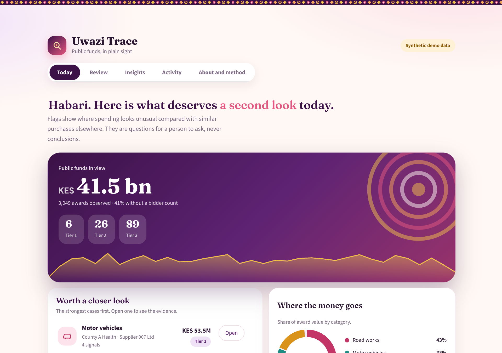
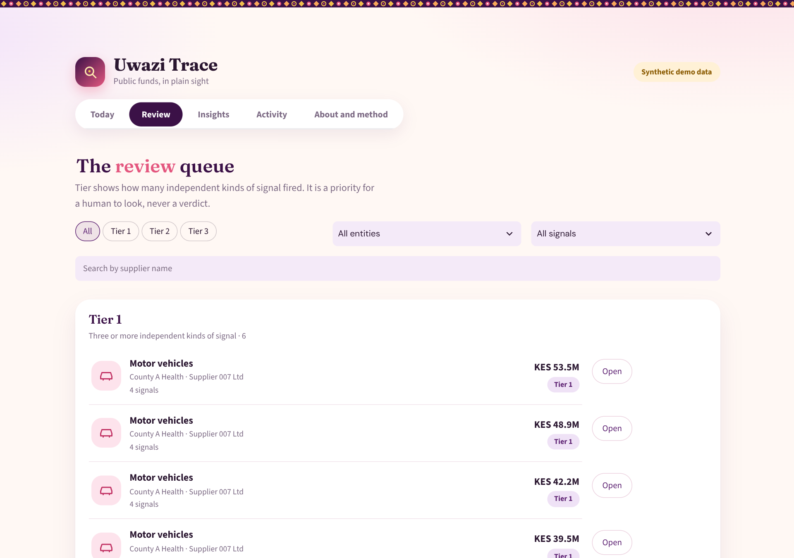
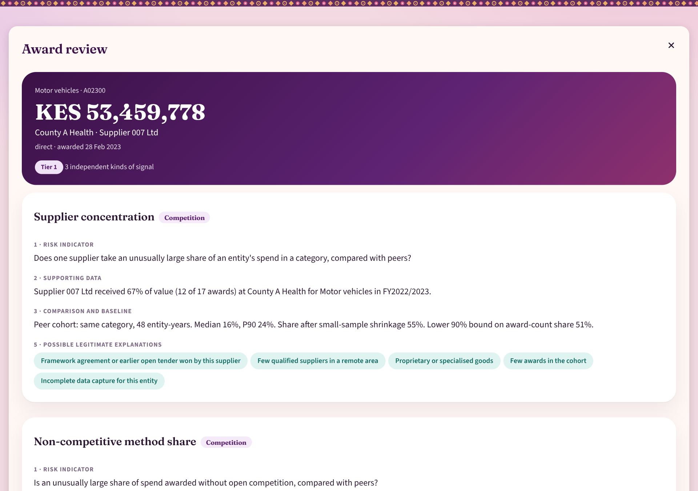
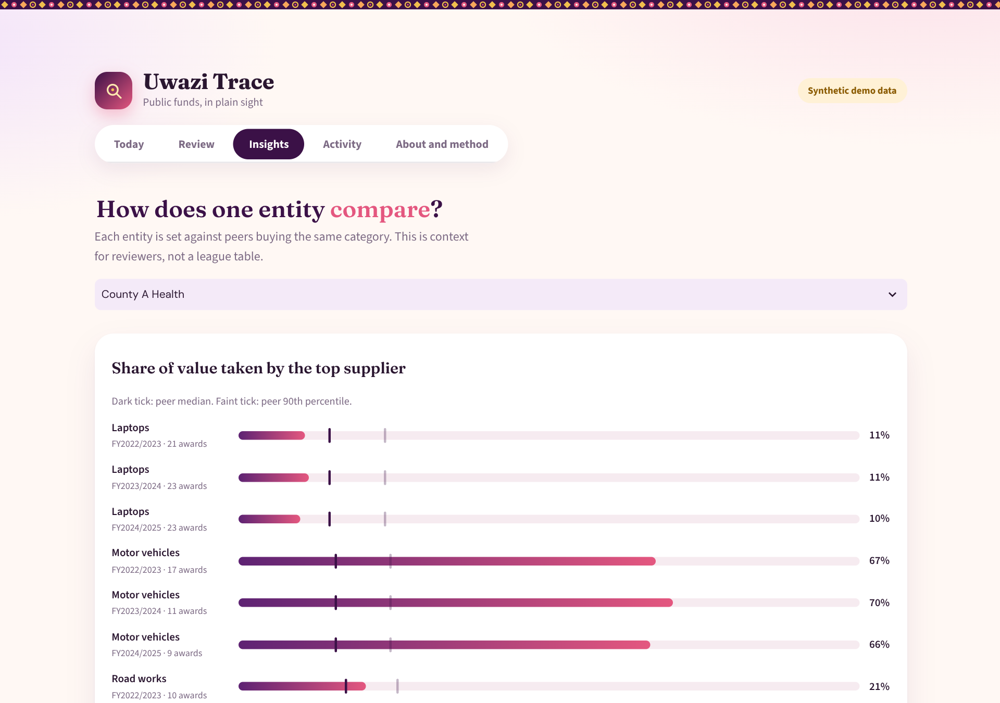
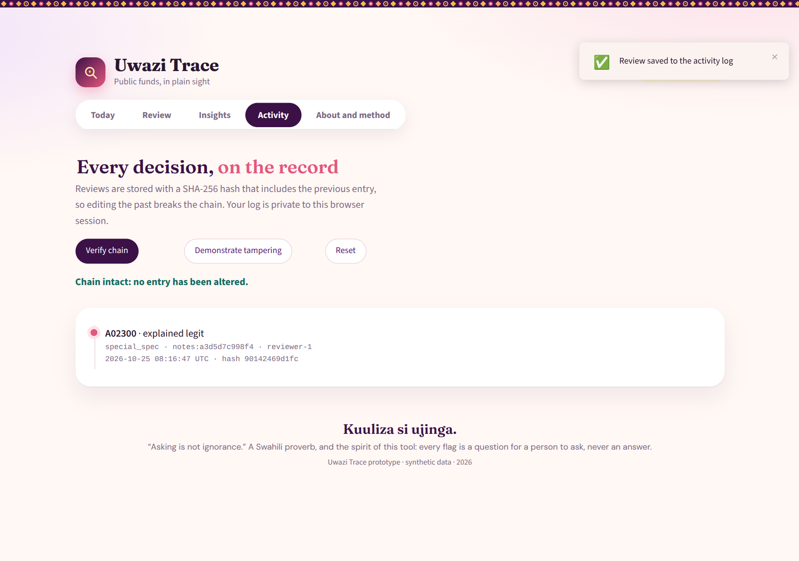
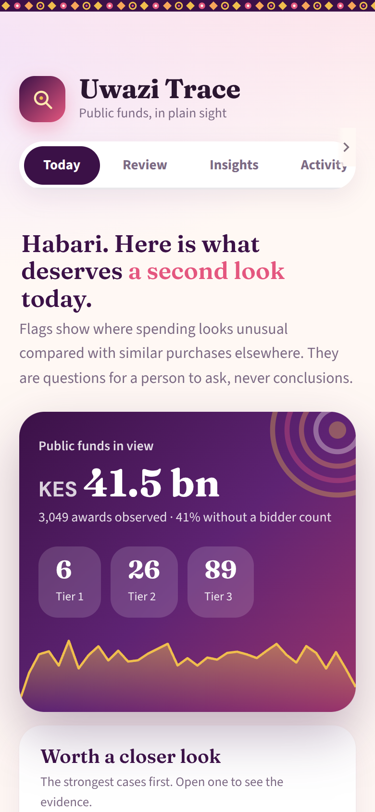
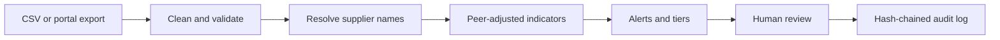

<div align="center">

# Uwazi Trace

**Public funds, in plain sight.**
An evidence-first review tool for public procurement data, built for Kenya.

[](https://github.com/Rene12-3/uwazi-trace/actions)




</div>

> **Status: prototype.** Everything you see runs on fully synthetic data. No real supplier, official or institution appears anywhere.
> A flag means *"unusual compared with similar purchases"*, never wrongdoing. This tool does not score people and does not detect corruption.

---

## Why this exists

Kenyan public money is governed by the Public Finance Management Act and the Public Procurement and Asset Disposal Act, and watched by the Auditor-General, the Controller of Budget, parliamentary committees, journalists and civil society.
The information they need is scattered across tender portals, award notices, budget PDFs and audit reports, in inconsistent formats. Review capacity is scarce.

So the useful question is not *"who is corrupt?"* It is:

> **Where should scarce review time go first, and what is the evidence?**

Uwazi Trace answers that. For every award it surfaces, it shows **what looks unusual, compared with what, how certain we are, which innocent explanations to check first, where the source is, and who decided what.**

## What makes it different

| Principle | In practice |
|---|---|
| **Evidence, not verdicts** | No "corruption score". Every alert shows data, a peer baseline, uncertainty and a source |
| **Compare like with like** | Peer cohorts by category; small samples are shrunk toward the peer median so tiny entities do not look extreme by chance |
| **Innocent explanations first** | Each signal lists the legitimate reasons a reviewer should rule out (emergency, special specification, framework agreement, and so on) |
| **Independent evidence, not summed evidence** | Correlated signals are grouped into families, so one story is never counted three times |
| **Missing is not zero** | Unknown bidder counts stay unknown; unparseable amounts are dropped and counted, never guessed |
| **Show the blind spots** | Data completeness and "what this view cannot see" come before findings |
| **Accountable decisions** | Every review is recorded in a SHA-256 hash-chained log; editing the past breaks the chain |
| **Neutral by construction** | Same rules for every entity; no ethnicity, party, region-as-proxy or personal-name inputs |

## A tour

<table>
<tr>
<td width="50%"><b>Review queue</b><br>Tiers show how many independent kinds of signal fired.<br></td>
<td width="50%"><b>Award review</b><br>Seven evidence components for every finding.<br></td>
</tr>
<tr>
<td><b>Peer comparison</b><br>An entity set against peers buying the same category.<br></td>
<td><b>Tamper-evident activity log</b><br>Reviews are hash-chained; try "Demonstrate tampering".<br></td>
</tr>
</table>

<p align="center"></p>

### The seven parts of every alert
1. **Risk indicator**: what kind of unusual pattern this is
2. **Supporting data**: the numbers for this award
3. **Comparison and baseline**: compared with whom, and how many comparators
4. **Confidence and uncertainty**: evidence grade and caveats
5. **Possible legitimate explanations**: what to rule out first
6. **Source documents**: where the record came from
7. **Audit trail**: who reviewed it and what they decided

## The five signals

| Code | Signal | Family | Question |
|---|---|---|---|
| `CONC` | Supplier concentration | Competition | Does one supplier take an unusually large share of an entity's spend in a category? |
| `METHOD` | Non-competitive method share | Competition | Is an unusual share awarded without open competition? |
| `TIMELINE` | Timeline integrity | Process | Do the dates break basic process rules? |
| `THRESH` | Threshold bunching or splitting | Process | Do awards cluster just under an approval limit, or do small repeats add up past it? |
| `PRICE` | Unit price vs comparable purchases | Price | Is the unit price high for the quantity, with a calibrated (conformal) upper bound? |

Full specifications, including innocent explanations and failure modes, are in [`docs/INDICATORS.md`](docs/INDICATORS.md).

## How it works



The analysis is a plain Python library (`src/uwazi`) with no UI dependency, so it can power a notebook, a batch job or an API.
Why statistics and not a neural network? There are no trustworthy corruption labels, so a supervised model would learn what investigators chose to pursue. See [`docs/METHODOLOGY.md`](docs/METHODOLOGY.md).

## Quick start

Requires Python 3.11 or newer.

```bash
git clone https://github.com/Rene12-3/uwazi-trace.git
cd uwazi-trace
pip install -r requirements.txt
streamlit run streamlit_app.py
```

Developer setup:

```bash
pip install -r requirements-dev.txt
make test     # 35 tests
make lint
```

With Docker: `make docker`, then open http://localhost:8501.

### Deploy a public demo (free)
1. Push this repository to GitHub.
2. At [share.streamlit.io](https://share.streamlit.io), choose **Create app**, select the repository and set the main file to `streamlit_app.py`.
3. Optional: add a secret or environment variable `FEEDBACK_URL` (a form or `mailto:` link) to show a feedback button.

Each visitor gets a private review log that disappears when the session ends. **Do not deploy this prototype with real or sensitive data.**

## Using your own data

Upload a CSV in the sidebar (template available there), or use [`data/sample_awards.csv`](data/sample_awards.csv). Columns:

| Column | Notes |
|---|---|
| `award_id`, `entity`, `category`, `method`, `supplier`, `source_url` | Text |
| `published_on`, `closes_on`, `award_date` | Dates |
| `award_value_kes`, `quantity` | Numbers. "KES 1,200,000" parses; garbage becomes missing |
| `bidder_count` | Blank means unknown, never "one bidder" |

Details and quality rules: [`docs/DATA_DICTIONARY.md`](docs/DATA_DICTIONARY.md).

## Project layout

```
streamlit_app.py        Streamlit front end
src/uwazi/
  config.py             Settings and constants (every threshold is explicit)
  cleaning.py           Parsing, normalisation, quality flags
  resolution.py         Supplier entity resolution (v0)
  indicators.py         The five signals and their catalogue
  alerts.py             Tiering and evidence grade
  audit.py              Reviews and hash-chained log
  synthetic.py          Benchmark data with planted patterns
  pipeline.py           End-to-end orchestration
  ui/                   Theme (kanga-inspired) and HTML components
tests/                  35 tests: cleaning, resolution, indicators, audit, pipeline
docs/                   Methodology, indicators, validation, ethics, architecture, roadmap, design
data/sample_awards.csv  Synthetic sample
```

## Validation, honestly

On a synthetic benchmark with planted patterns, the detectors recover 100% of concentration, splitting, bunching and short-window cases and 47% of inflated prices (deliberately conservative).
Supplier name resolution turns 362 messy names back into the true 120 with no wrong merges.
**These are upper bounds.** The data is clean and random. Real performance is unknown until auditors and procurement practitioners blind-review real alerts, which is the first goal of the pilot.
With a low base rate, even a good detector has modest precision (see the worked example in [`docs/VALIDATION.md`](docs/VALIDATION.md)), which is exactly why this is a triage tool and not an accusation tool.

## Limitations

- Prototype on synthetic data; no authentication and no real-data safeguards
- Published awards are a non-random subset of spending; entities that publish more produce more flags
- Prices do not model specifications or (by default) inflation
- Thresholds and minimum bid windows are **assumptions you set**; verify them against the Regulations in force on the award date
- No relationship graph, OCR, budget-to-payment reconciliation or project-status checks yet

## Roadmap

Feasibility on real data, then a private pilot with an oversight or journalism partner, then deeper indicators and institutional features. Each phase has an exit criterion. See [`docs/ROADMAP.md`](docs/ROADMAP.md).

## Responsible use

Read [`docs/ETHICS_AND_LEGAL.md`](docs/ETHICS_AND_LEGAL.md) before using real data. In short: never publish about a named entity without a right of reply, never use sensitive attributes or names as signals, and treat every flag as a question, not an answer.
This is a framework, not legal advice. Get Kenyan legal review (Access to Information Act, Data Protection Act, Computer Misuse and Cybercrimes Act, defamation) before going near real data.

## Contributing

Contributions are welcome and held to a high standard of care. Start with [`CONTRIBUTING.md`](CONTRIBUTING.md).

## Author

Built by **YOUR NAME**. <!-- replace with your name and a link -->

## Acknowledgements

Fonts: [Fraunces](https://github.com/undercasetype/Fraunces) and [DM Sans](https://github.com/googlefonts/dm-fonts), SIL Open Font License. Design inspired by kanga cloth.

<div align="center">

*Kuuliza si ujinga.* Asking is not ignorance.

</div>
